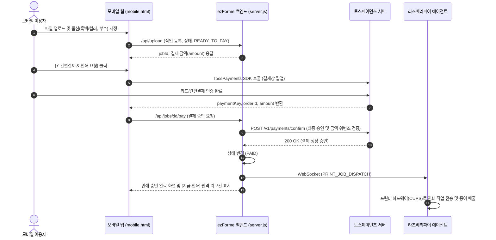

# 🖨️ ezForme: 현장 실증(Field Test) 전체 로드맵 및 하드웨어 구매 가이드

- **작성일자**: 2026년 10월 20일
- **작성자**: AI 개발부장 'one' (one 개발부장)
- **수신**: 아이그리드 대표님
- **프로젝트 위치**: `/Users/macbook/Desktop/igrid/ezforme/`

---

## 1. 📌 현장 실증 테스트(POC) 개요 및 목표

### 1.1 핵심 미션
> **"전국 스터디카페로 확장하기 전, 단 1곳의 실제 매장(또는 연구실)에서 드라이버 없는 무인 클라우드 인쇄 사이클을 100% 무결점으로 검증한다!"**

### 1.2 실증 3대 성공 지표 (Success Metrics)
1. **기술 무결성 (Zero-Failure)**: 스마트폰 QR 스캔부터 실제 종이 배출까지 **평균 5초 이내** 완료.
2. **현장 안정성 (Durability)**: 24시간 가동 중 전원 강제 차단이나 Wi-Fi 일시 단절 시 **자동 재부팅 및 100% 자동 복구**.
3. **사용자 만족도 (Zero-Friction)**: 점주의 도움이나 개입 없이 일반 손님이 **100% 자가 인쇄 및 결제 성공**.

---

## 2. 🛒 테스트용 하드웨어 구매 가이드 및 상세 견적표

현장 테스트를 위해 구매해야 할 하드웨어는 **[개발/검증용 1호기]**와 **[현장 배포용 양산기]**의 2가지 옵션이 있습니다. 

* 💡 **one 부장 강력 추천**: 
  * 최초 연구실/사무실 개발 및 1호 매장 테스트에는 포트가 넉넉하고 세팅이 편한 **'라즈베리파이 4B'**를 권장합니다.
  * 검증 완료 후 매장에 대량 보급할 때는 2만 원대 초소형 **'라즈베리파이 제로 2 W'**로 전환하는 것이 가장 안전합니다.

---

### 2.1 [옵션 A: 1호 테스트 강력 추천] 라즈베리파이 4 Model B 풀세트
일반 PC와 동일한 표준 USB-A 포트가 4개 있어 케이블 젠더가 필요 없고, 넉넉한 2GB RAM으로 대용량 PDF 처리 속도가 빠릅니다.

| 품목 | 상세 스펙 | 적정 가격 (VAT 포함) | 주요 구매처 및 검색 키워드 | 비고 |
| :--- | :--- | :--- | :--- | :--- |
| **1. 메인보드** | 라즈베리파이 4 Model B (2GB or 4GB) | **68,000원 ~ 82,000원** | 디바이스마트, 아이씨뱅큐, 쿠팡 | 2GB 모델로도 인쇄 서버 차고 넘침 |
| **2. 전원 어댑터** | 5V 3.0A USB Type-C 공식 정품 어댑터 | **11,000원 ~ 13,000원** | 디바이스마트, 쿠팡 | 저가 스마트폰 충전기는 전압 강하 위험 |
| **3. 케이스 & 방열판** | Pi 4 전용 알루미늄 또는 아크릴 쿨링 케이스 | **6,000원 ~ 10,000원** | 디바이스마트, 네이버쇼핑 | 쇼트(정전기) 방지 및 24시간 방열 |
| **4. MicroSD 카드** | 삼성 EVO Plus 또는 SanDisk Ultra 32GB (Class 10) | **7,000원 ~ 9,000원** | 쿠팡 로켓배송, 네이버 | 16GB~32GB 충분 (읽기 속도 중요) |
| **5. 프린터 USB 케이블** | USB Type-A to Type-B (1.5m) | **2,500원 ~ 4,000원** | 쿠팡, 다이소, 디바이스마트 | 프린터 뒷면 네모난 포트 연결용 |
| **합계 (옵션 A)** | **풀세트 1대 기준** | **약 94,500원 ~ 118,000원** | - | **초기 개발 및 1호점 실증용** |

---

### 2.2 [옵션 B: 현장 배포용 극가성비] 라즈베리파이 제로 2 W 풀세트
신용카드 절반 크기, 껌 한 갑 크기로 프린터 뒤편에 양면테이프로 완벽 은폐 가능한 초소형 단말기입니다.

| 품목 | 상세 스펙 | 적정 가격 (VAT 포함) | 주요 구매처 및 검색 키워드 | 비고 |
| :--- | :--- | :--- | :--- | :--- |
| **1. 메인보드** | 라즈베리파이 제로 2 W (Raspberry Pi Zero 2 W) | **27,500원** | 디바이스마트 (공식 판매처) | 쿼드코어 CPU, 512MB RAM, Wi-Fi |
| **2. 전용 케이스** | Zero 2 W 공식 케이스 (뚜껑 3종 포함) | **5,500원 ~ 7,000원** | 디바이스마트 | 콤팩트 화이트/레드 케이스 |
| **3. 전원 어댑터** | 5V 2.5A Micro-USB (5핀) 어댑터 | **7,000원 ~ 9,000원** | 디바이스마트, 쿠팡 | 안정적 전원 공급 필수 |
| **4. OTG 젠더 케이블** | Micro-USB (5핀) to USB Type-A 암 젠더 | **1,500원 ~ 2,500원** | 디바이스마트, 네이버 | 프린터 USB 선을 꽂기 위한 변환 젠더 |
| **5. MicroSD 카드** | SanDisk Ultra 32GB MicroSD | **7,000원 ~ 9,000원** | 쿠팡 로켓배송 | OS 및 에이전트 내장 |
| **6. 프린터 케이블** | USB Type-A to Type-B (1.5m) | **2,500원 ~ 4,000원** | 쿠팡, 다이소 | 기존 프린터 선 재활용 가능 |
| **합계 (옵션 B)** | **풀세트 1대 기준** | **약 51,000원 ~ 59,000원** | - | **전국 매장 양산 배포용** |

---

### 2.3 대표님 사전 준비 공구 (집/사무실 보유 확인)
1. **MicroSD 카드 리더기**: 대표님 맥북에 MicroSD 카드를 꽂아 리눅스 이미지를 굽기 위한 USB 리더기 (다이소 3천 원 또는 기존 보유품).
2. **테스트용 프린터**: 대표님 연구실/자택 프린터 또는 지인 사무실 프린터 (삼성, HP, 캐논 등 기종 무관).

---

## 3. 🗺️ 현장 실증(Field Test) 5단계 액션 로드맵

```
[Day 1~3] 하드웨어 수급 & OS 굽기 ──▶ [Day 4~5] 연구실 벤치 테스트 ──▶ [Day 6~8] 1호점 무상 설치
                                                                                   │
[Day 21~] 상용 패키징 & B2B 영업  ◀── [Day 9~20] 2주간 실사용 데이터 수집 ◀──────┘
```

---

### 🚀 Phase 1: 하드웨어 수급 및 마스터 OS 세팅 (Day 1 ~ Day 3)
* **Day 1: 부품 주문**
  * 디바이스마트 또는 쿠팡에서 라즈베리파이 세트 1대 주문 (익일 도착).
* **Day 2: 마스터 SD 카드 이미지 제작 (대표님 맥북)**
  * Raspberry Pi Imager를 사용하여 `Raspberry Pi OS Lite (64-bit)` 설치.
  * Wi-Fi 자동 접속(SSID/PW) 및 SSH 원격 제어 활성화.
  * **전원 차단 무적 세팅 (OverlayFS)**:
    ```bash
    # 터미널에서 읽기 전용 파일시스템 활성화
    sudo raspi-config nonint enable_overlayfs
    ```
    *(→ 콘센트가 갑자기 뽑혀도 SD 카드가 절대 깨지지 않는 산업용 모드 전환)*
* **Day 3: ezForme 에이전트 및 CUPS 자동 연동**
  * 리눅스 인쇄 엔진 `CUPS` 설치 및 RAW 9100 / IPP 스풀러 설정.
  * Node.js 경량 클라이언트 백그라운드 데몬(`systemd`) 등록 (부팅 시 3초 만에 자동 실행).

---

### 🧪 Phase 2: 연구실/사무실 벤치 테스트 (Day 4 ~ Day 5)
* **테스트 환경**: 대표님 연구실/사무실의 실제 프린터에 USB 케이블 연결.
* **10대 극한 시나리오 스트레스 테스트**:
  1. **스마트폰 QR 인쇄**: 아이폰(사파리), 갤럭시(크롬)에서 PDF 3장 연속 출력 속도 측정.
  2. **노트북 단축 주소 인쇄**: 노트북 브라우저에서 `ezforme.kr` 접속 후 매장코드 입력 인쇄.
  3. **결제 연동 테스트**: 카카오페이/토스페이 100원 결제 승인 및 취소 테스트.
  4. **강제 전원 차단 테스트**: 인쇄 도중 전원 코드를 뽑고, 다시 꽂았을 때 30초 내 자동 복구 여부 검증.
  5. **인터넷 단절 테스트**: 공유기를 껐다 켰을 때 에이전트가 서버와 웹소켓 자동 재연결 성공 여부.
  6. **대용량 파일 테스트**: 20MB 고화질 PDF 업로드 시 렌더링 딜레이 및 인쇄 성공 확인.

---

### 🏬 Phase 3: 1호 파일럿 매장 섭외 및 현장 설치 (Day 6 ~ Day 8)
* **타깃 매장**: 대표님 지인의 스터디카페, 자주 가시는 단골 공유오피스 또는 게스트하우스 1곳.
* **점주 설득 100% 무적 스크립트**:
  > *"사장님! 돈 한 푼 안 받습니다. 일주일만 테스트하게 프린터 뒤에 이 손바닥만 한 박스 하나만 꽂게 해주세요. 손님들이 '사장님 출력 어떻게 해요?' 하고 물어보는 귀찮은 전화 오늘부터 싹 사라집니다. 발생하는 인쇄비는 사장님 통장으로 전액 입금해 드립니다!"*
* **현장 설치 작업 (소요시간 5분)**:
  1. 프린터 뒷면에 라즈베리파이 USB 케이블 연결.
  2. 콘센트에 전원 어댑터 연결.
  3. 프린터 상단에 **A4 방수 코팅 안내 스티커(QR코드 + 4자리 번호)** 부착.
  4. 테스트 인쇄 1장 성공 확인 후 철수.

---

### 📊 Phase 4: 2주간 현장 실사용 데이터 수집 (Day 9 ~ Day 20)
* **원격 모니터링 대시보드 가동**:
  * 매일 인쇄 건수, 이용 시간대, 실패율(용지 걸림 등) 실시간 로깅.
* **에러 대응 및 자동 환불 검증**:
  * 종이 걸림이나 용지 부족 발생 시 시스템이 즉시 감지하여 고객에게 1초 자동 환불이 정상 작동하는지 확인.
* **현장 인터뷰 (1주 차 / 2주 차)**:
  * **이용자 반응**: "드라이버 안 깔아서 진짜 편했는가?", "결제가 쉬웠는가?"
  * **점주 반응**: "문의 전화가 진짜 줄었는가?", "정산받은 수익에 만족하는가?"

---

### 🏆 Phase 5: 유닛 이코노믹스 검증 및 전국 확장 패키징 (Day 21 ~)
* **1개 매장 실데이터 기반 경제성 분석**:
  * 일평균 인쇄량, 월 총매출, 점주 정산금, 우리 플랫폼 순이익 산출.
  * 단말기 1대당 투자금(5만 원) 회수 기간 확정.
* **B2B 프랜차이즈 영업 제안서 완성**:
  * 1호 매장의 실제 데이터("문의 전화 90% 감소, 매달 부가수익 8만 원 창출!")를 담은 **'스터디카페 프랜차이즈 본사용 1장 제안서'** 제작.
  * 전국 5,000개 스터디카페 협회 및 커뮤니티로 공격적 확장 시작.

---

## 4. 🛠️ 사전 체크리스트 요약표

| 단계 | 체크 항목 | 완료 여부 |
| :--- | :--- | :---: |
| **구매** | 라즈베리파이 4B(또는 Zero 2 W) + 케이스 + 전원어댑터 + SD카드 32GB 주문 | [ ] |
| **제작** | OS 굽기 + Read-Only 무적 세팅 + ezForme 에이전트 데몬 설치 | [ ] |
| **벤치** | 대표님 사무실 프린터 직결 10대 스트레스 테스트 통과 | [ ] |
| **디자인** | 현장 부착용 안내 스티커 (QR + 4자리 매장코드) 방수 코팅 인쇄 | [ ] |
| **결제연동** | 토스페이먼츠 개발자센터 가입 & 테스트 API 키 발급 및 시스템 연동 | [x] 완료 (Client/Secret Key 연동 완료) |
| **섭외** | 파일럿 테스트 1호 매장 점주 동의 확보 (무상 시범 운영) | [ ] |
| **모니터링** | 실시간 원격 관제 및 결제 실패/용지 부족 자동 환불 파이프라인 가동 | [ ] |
| **PG심사** | 파일럿 실증 중 사업자등록증 기반 토스 가맹점 전자계약 & 카드사 심사 신청 | [ ] |

---

## 5. 💳 토스페이먼츠(PG) 결제 연동 마스터 플랜 & 운영 가이드

현장 파일럿 매장에서 실제 고객의 인쇄 요금을 결제받기 위한 PG 연동 종합 지침입니다.

### 5.1 결제창 연결 위치 명세: 랜딩페이지 vs 모바일 출력페이지

결제 프로그램의 연동 위치는 **100% "이용자가 접속하는 모바일 출력 페이지(`mobile.html` 또는 `/p/:stationId`)"**입니다.

| 구분 | 랜딩페이지 (`index.html`) | 모바일 출력/주문 페이지 (`mobile.html`) |
| :--- | :--- | :--- |
| **페이지 목적** | B2B 가맹점주 모집, 솔루션 소개, 제휴 문의 접수 | QR코드를 스캔한 실제 이용자의 **문서 업로드 및 인쇄 실행** |
| **주요 접속자** | 스터디카페 점주, 공유오피스 매니저, 투자자 | 매장에서 지금 당장 종이를 뽑아야 하는 일반 손님 |
| **결제 연동 여부** | ❌ **연동 불필요** (현 단계에서 과금 없음) | ⭕ **필수 연동 (장당 100~200원 실시간 결제창 팝업)** |

```
[고객 여정]
복합기 앞 스탠드 QR 스캔
  └──▶ 모바일 페이지 접속 (/p/STATION-01)
        └──▶ 파일 업로드 & 매수/컬러 옵션 선택
              └──▶ [⚡ 토스페이먼츠 간편결제 위젯 팝업] 
                    └──▶ 결제 승인 완료 ──▶ 라즈베리파이로 인쇄 즉시 명령 전송!
```

---

### 5.2 토스페이먼츠 연동 3단계 로드맵

PG사 연동 경험이 없어도 걱정할 필요가 없도록 3단계로 표준화하여 진행합니다.

```
[Phase 1: 개발 및 가상 결제 연동] (소요시간: 10분, 즉시 가능)
   │ • 사업자등록증 불필요 (누구나 토스 개발자센터 가입 즉시 시작)
   │ • 테스트 API 키(Client Key, Secret Key) 발급
   │ • 저 one 부장이 프론트/백엔드 코드 연동 완료
   │ • 스마트폰에서 실제 토스 결제창(가상 카드, 카카오페이, 토스페이 등) 팝업 및 승인 테스트
   ▼
[Phase 2: 가맹점 전자계약 & 카드사 심사] (파일럿 운영 중 병행 진행)
   │ • 대표님 사업자등록증 + 통신판매업 신고
   │ • 웹사이트 필수 고지사항(이용약관, 개인정보처리방침, 환불규정, 사업자정보 푸터) 구비
   │ • 토스페이먼츠 콘솔에서 '온라인 전자계약' 신청
   │ • 8개 카드사 가맹 심사 진행 (영업일 기준 1~2주 소요) ➡️ 통과 시 '실서비스 라이브 키(Live Key)' 발급
   ▼
[Phase 3: 실서비스 스위치 ON]
     • 시스템 환경설정(.env)의 API 키를 Test Key에서 Live Key로 1초 교체
     • 실제 고객 결제 발생 시 대표님 통장으로 D+3영업일 자동 정산 시작!
```

---

### 5.3 시스템 아키텍처 및 데이터 흐름도



---

### 5.4 역할 분담표 (R&R Matrix: 대표님 vs one 부장)

| 구분 | 🛠️ AI one 개발부장 (기술 100% 전담) | 💼 대표님 (운영 및 행정) |
| :--- | :--- | :--- |
| **프론트엔드** | • `mobile.html` 내 토스 SDK 및 결제위젯 삽입<br>• 카카오페이/토스페이/네이버페이/신용카드 결제 UI 구현 | - |
| **백엔드/보안** | • `server.js` 토스 승인 API(`v1/payments/confirm`) 구현<br>• 결제 금액 위변조 방지 검증<br>• 용지 걸림/실패 시 자동 결제 취소(환불) 로직 탑재 | - |
| **하드웨어 연동** | • 결제 완료 신호와 라즈베리파이 CUPS 인쇄 큐 실시간 결합 | - |
| **행정/계약** | - | • [토스 개발자센터](https://developers.tosspayments.com) 가입 후 테스트 키 발급<br>• 정식 상용화 시 사업자 서류 제출 및 전자계약 체결 |

---

### 5.5 대표님 원클릭 가이드: 테스트 키 발급 3단계

1. **토스페이먼츠 개발자센터 접속**: [developers.tosspayments.com](https://developers.tosspayments.com)
2. **무료 회원가입 및 로그인** (개인 이메일/토스 계정 간편 로그인 가능)
3. **[API 키] 메뉴 진입 후 아래 2가지 테스트 키를 복사하여 one 부장에게 전달**:
   * **클라이언트 키 (Client Key)**: `test_ck_...` (화면 결제창 호출용)
   * **시크릿 키 (Secret Key)**: `test_sk_...` (서버 승인 및 검증용)

> 💡 **one 부장의 조언**: 테스트 키만 전달해주시면, 대표님 맥북 로컬 및 스마트폰에서 즉시 실제 결제창이 뜨는 감동적인 인쇄 풀사이클을 30분 안에 세팅해 드립니다!

